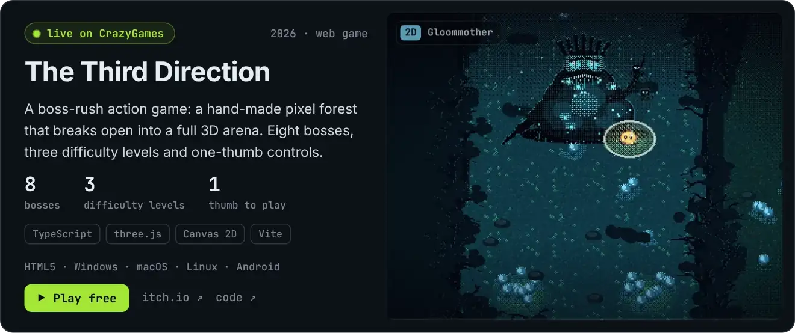

# The Third Direction: live portfolio card

A drop-in project card for a portfolio site. The left side has the title, status, description, stats and links. The right side plays a 13.5-second loop of **real gameplay** at 60 frames a second, captured from the game frame by frame. It shows **all eight bosses**, each on a fast cut (about 1.4 s) of its busiest moment:

1. the five guardians of the 2D pixel forest: Gloommother, the Thornback King, the Toll Queen, the Bone Wyrm, the Mimic Queen;
2. X's eyes in the sky, and the world tearing open onto the third dimension;
3. the three bosses of the 3D world: X, the Hollow, the Collector, the Mash.

The game runs 1.3 times as fast as it plays in the footage.

A label on the video names each shot, with a 2D or 3D tag that is kept in step with the video.


| File | What it is |
|---|---|
| `ttd-card.js` | The card: one ES module with no dependencies. It defines `<ttd-card>` and exports `mountTTDVideo()`. |
| `ttd-preview.mp4` | The gameplay loop: 13.5 s, 960x540, 60 fps, H.264, no sound, 2.2 MB. Every current browser plays it. |
| `ttd-preview.webm` | The same loop in VP9 (3.8 MB), a fallback for browsers built without H.264. |
| `ttd-poster.jpg` | The tear (the forest and the 3D world in one frame), shown before the video loads and to people who ask for reduced motion. |
| `demo.html` | The card at desktop and phone width. Serve the folder (`python3 -m http.server`) and open it; ES modules don't load from `file://`. |
| `card.png` | The card as a still image, for a README or a social post. |
| `readme-card.webp` | The card as an animated WebP (3.8 MB), for a GitHub README, where scripts can't run. |

Links the card uses (all overridable):

- Play: https://www.crazygames.com/game/the-third-direction-vjd
- itch.io: https://gautam-jain.itch.io/the-third-direction
- Code: https://github.com/rubella2121/gamedev

The footage is made by `tools/trailer/shots-card.mjs` (the shots, played by the game's own bots) and `tools/trailer/card-loop.py` (the cut, which picks each boss's busiest stretch). Run those again to remake it after the game changes. The forest is cropped from the game's own pixels and scaled up with nearest neighbour first, so it stays sharp.

---

## For the agent doing the integration

1. **Copy four files into the site's static folder,** for example `public/`, or wherever the site serves files as they are: `ttd-card.js`, `ttd-preview.mp4`, `ttd-preview.webm` and `ttd-poster.jpg`. Don't hotlink them from raw.githubusercontent.com: that host serves `text/plain`, so browsers refuse to run the script, and it isn't meant for video.
2. **Find the existing card for The Third Direction** and replace it, keeping its place in the grid or list. If the site has no such card, add it where the other projects are.
3. **Choose route A or route B** below.
4. **Point the card at the media** if the files aren't next to `ttd-card.js` (see Attributes).
5. **Match the site's look** with the `--ttd-*` tokens. The defaults already match a GitHub-dark site: `#0d1117` background, `#30363d` borders, `#e6edf3` text and a lime accent of `#a3e635`.
6. **Check it** against the acceptance list at the end.

Don't re-encode, crop or speed up the video. If the label times change, they live in `TTD_SEGMENTS` in `ttd-card.js`, and they must match the video.

### Route A: the whole card (recommended)

The element uses a shadow DOM, so its CSS can't leak into the site, or the site's into it. It inherits the page's font.

**Plain HTML,** with the four files in the same folder:

```html
<ttd-card></ttd-card>
<script type="module" src="/ttd-card.js"></script>
```

**React / Next.js (App Router),** with the files in `public/`. The script loads on the client:

```tsx
'use client';
import Script from 'next/script';

export function ThirdDirectionCard() {
  return (
    <>
      <Script src="/ttd-card.js" type="module" strategy="afterInteractive" />
      <ttd-card mp4="/ttd-preview.mp4" webm="/ttd-preview.webm" poster="/ttd-poster.jpg" />
    </>
  );
}
```

Importing it as a module (`useEffect(() => { import('@/lib/ttd-card.js') }, [])`) also works. If you do that, keep the attributes, because a bundled copy can't find the videos beside itself.

TypeScript needs to know the tag. Add this to a `.d.ts` file:

```ts
import type { DetailedHTMLProps, HTMLAttributes } from 'react';
type TTDCardProps = DetailedHTMLProps<HTMLAttributes<HTMLElement>, HTMLElement> & {
  play?: string; itch?: string; source?: string; webm?: string; mp4?: string; poster?: string;
};
declare module 'react' {
  namespace JSX { interface IntrinsicElements { 'ttd-card': TTDCardProps } }   // React 19
}
declare global {
  namespace JSX { interface IntrinsicElements { 'ttd-card': TTDCardProps } }   // React 18
}
```

**Astro** (files in `public/`):

```astro
<ttd-card mp4="/ttd-preview.mp4" webm="/ttd-preview.webm" poster="/ttd-poster.jpg"></ttd-card>
<script type="module" src="/ttd-card.js" is:inline></script>
```

**Vue**

Tell the compiler the tag is a custom element: in `vite.config`, set `vue({ template: { compilerOptions: { isCustomElement: (tag) => tag === 'ttd-card' } } })`. Then load `/ttd-card.js` once.

**Svelte, Solid, Lit, others**

Load the module once and write the tag.

**Reserve its space** so the page doesn't jump while the module loads. The card is about 370 px tall when wide (700 px or more) and 575 to 700 px when narrow.

```css
ttd-card:not(:defined) { display: block; min-height: 370px; border: 1px solid #30363d; border-radius: 14px; }
@media (max-width: 760px) { ttd-card:not(:defined) { min-height: 580px; } }
```

**Attributes**

All are optional.

| Attribute | Default |
|---|---|
| `play` | the CrazyGames page |
| `itch` | the itch.io page |
| `source` | the GitHub repo |
| `mp4` | `ttd-preview.mp4` next to `ttd-card.js` |
| `webm` | `ttd-preview.webm` next to `ttd-card.js` |
| `poster` | `ttd-poster.jpg` next to `ttd-card.js` |

**Text**

The title, description, stats (8 bosses, 3 difficulty levels, 1 thumb), stack chips, platform line and the "live on CrazyGames" pill are in `TTDCard.render()` near the end of `ttd-card.js`. Edit them there. Keep them true:

- the game is live on CrazyGames and itch.io;
- it's built with TypeScript, three.js, Canvas 2D and Vite.

### Route B: only the gameplay preview, inside the site's own card markup

Use this when every project on the site shares one card component and this one should look the same.

```html
<a class="ttd-preview" href="https://www.crazygames.com/game/the-third-direction-vjd" target="_blank" rel="noopener" tabindex="-1" aria-hidden="true">
  <video muted loop playsinline preload="none" poster="/ttd-poster.jpg">
    <source data-src="/ttd-preview.mp4" type="video/mp4">
    <source data-src="/ttd-preview.webm" type="video/webm">
  </video>
  <span class="ttd-seg"></span>
  <span class="ttd-bar"><i></i></span>
</a>
```

The sources use `data-src`, so nothing downloads until the card comes near the screen.

```js
import { mountTTDVideo } from '/ttd-card.js';
const preview = mountTTDVideo(document.querySelector('.ttd-preview video'), {
  label: document.querySelector('.ttd-seg'), // optional: gets <b>2D|3D</b><span>shot name</span> and data-dim
  bar: document.querySelector('.ttd-bar'),   // optional: gets --p, 0..1 through the loop
  hoverTarget: document.querySelector('.ttd-preview'),
});
// on unmount: preview.destroy();
```

```css
.ttd-preview { position: relative; display: block; aspect-ratio: 16 / 9; border-radius: 10px; overflow: hidden; background: #05060c; }
.ttd-preview video { position: absolute; inset: 0; width: 100%; height: 100%; object-fit: cover; }
.ttd-seg { position: absolute; left: 10px; top: 10px; display: inline-flex; gap: 7px; align-items: center; padding: 4px 9px 4px 4px; border-radius: 7px; font: 600 11px/1 ui-monospace, monospace; color: #e6edf3; background: rgba(5,6,12,.6); }
.ttd-seg b { padding: 3px 5px; border-radius: 4px; color: #0d1117; background: #7fd8f5; }
.ttd-seg[data-dim="3D"] b { background: #ff6a6a; }
.ttd-bar { position: absolute; inset: auto 0 0 0; height: 2px; background: rgba(255,255,255,.08); }
.ttd-bar i { position: absolute; inset: 0 auto 0 0; width: calc(var(--p, 0) * 100%); background: #a3e635; }
```

In React, run `mountTTDVideo` in a `useEffect` on refs and call `destroy()` in its cleanup.

---

## Theming tokens

Set these on any ancestor, such as `:root` or the projects grid. Every one is optional. If the site uses Tailwind, point them at the theme's values.

| Token | Default | Used for |
|---|---|---|
| `--ttd-surface` | `#0d1117` | card background |
| `--ttd-border` | `#30363d` | card border, stack chips |
| `--ttd-text` | `#e6edf3` | title, description, numbers |
| `--ttd-muted` | `#7d8590` | labels, year, platforms, secondary links |
| `--ttd-accent` | `#a3e635` | status pill, Play button, progress line, hover light |
| `--ttd-radius` | `14px` | card corners |
| `--ttd-display` | `inherit` | title font |
| `--ttd-mono` | `ui-monospace, "JetBrains Mono", …` | pill, stats, chips, links, video label |

The video is a night scene in every theme. On a light site, change only the text-side tokens.

## Layout

- The card responds to its own width (a container query), not the window's, so it fits any grid column.
- **700 px wide or more:** text on the left, video on the right. The video fills the card's height, at least 260 px, cropped to cover.
- **Narrower:** the video sits on top at 16:9, with the text under it.

## Behaviour

- **Loading:** nothing downloads until the card is within 200 px of the screen. Then the browser takes the MP4, or the WebM where it can't play H.264.
- **Playing:** muted, looping and inline (no fullscreen takeover on iPhone). A thin line along the bottom shows how far through the loop it is. The label at the top left changes with each shot.
- **Pausing:** it pauses when the card leaves the screen or the tab is hidden.
- **Reduced motion:** with `prefers-reduced-motion: reduce`, it shows the poster and plays only while the card is hovered or focused. The card then has no lift and no ping.
- **Links:** the whole video links to the game. The card lifts 2 px on hover, and a line of light follows the pointer along its top edge.
- **Screen readers:** the video is `aria-hidden` and taken out of the tab order. The title and the Play button carry the same link for keyboard and screen-reader users.

**Controller.** Both routes give you one: `el.preview` on the element, or the return value of `mountTTDVideo()`. It has `play()`, `pause()` and `destroy()`.

## GitHub README version

A README can't run scripts or play this video inline, so use the animated image and link it to the game:

```md
[](https://www.crazygames.com/game/the-third-direction-vjd)
```

Use `card.png` in the same way where animation isn't wanted.

## Acceptance checklist

- [ ] The card shows on the projects page in place of the old one, and the browser console has no errors.
- [ ] The video plays on its own, muted, in Chrome, Firefox and Safari, including Safari on an iPhone, where it plays inline.
- [ ] The label at the top left changes with the shots: Gloommother, Thornback King, Toll Queen, Bone Wyrm, Mimic Queen, X, in the sky, the world tears open, X, the Hollow, the Collector, the Mash.
- [ ] The Network panel shows no video request until the card is near the screen, and only one of the two files is downloaded.
- [ ] Scrolling the card off screen pauses the video.
- [ ] It looks right at 360 px, 768 px and 1280 px wide: no horizontal scroll and no clipped text.
- [ ] With reduced motion turned on in the OS, the poster shows and the video plays only on hover.
- [ ] Tab reaches the title link, Play free, itch.io and code, each with a visible focus ring. The video isn't a tab stop.
- [ ] Play free, the title and the video open the CrazyGames page in a new tab. itch.io and code open their pages.
- [ ] The page doesn't jump while the module loads (space reserved with `:not(:defined)`, route A).
