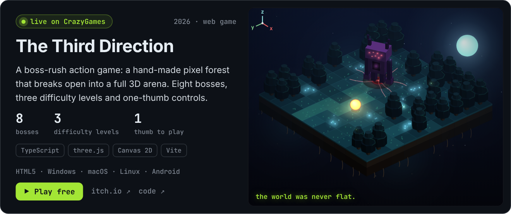

# The Third Direction: live portfolio card

A drop-in project card for a portfolio site. The left side has the title, status, description, stats and links. The right side is a live preview drawn in code: the game's top-down pixel forest tilts up into a floating 3D island, the pixels sharpen into HD, X rises out of the ground and the Blob lances it, then the world folds flat again.



| File | What it is |
|---|---|
| `ttd-card.js` | The whole card: one ES module, no dependencies, no assets, about 50 KB unminified (about 16 KB gzipped). It defines `<ttd-card>` and exports `mountTTDPreview()`. |
| `demo.html` | The card at desktop and phone width. Serve the folder (`python3 -m http.server`) and open it; ES modules don't load from `file://`. |
| `card.png` | The card as a still image, for a README, a social post or a no-JS fallback. |
| `poster.png` | The preview alone at 1280x720, in its 3D state. |
| `readme-card.webp` | The card as an animated WebP (13 s loop, 2.7 MB), for a GitHub README, where scripts can't run. |

Links the card uses (all overridable):

- Play: https://www.crazygames.com/game/the-third-direction-vjd
- itch.io: https://gautam-jain.itch.io/the-third-direction
- Code: https://github.com/rubella2121/gamedev

---

## For the agent doing the integration

1. **Copy `ttd-card.js` into the site's repo**, for example `public/ttd-card.js` or `src/lib/ttd-card.js`. Don't hotlink it from raw.githubusercontent.com: that host serves `text/plain`, so browsers refuse to run it.
2. **Find the existing card for The Third Direction** and replace it, keeping its place in the grid or list. If the site has no such card, add it where the other projects are.
3. **Choose route A or route B** below.
4. **Match the site's look** with the `--ttd-*` tokens. The defaults already match a GitHub-dark site: `#0d1117` background, `#30363d` borders, `#e6edf3` text and a lime accent of `#a3e635`.
5. **Check it** against the acceptance list at the end.

Don't change the preview's art, colours or timing. They come from the game's own palette (`the-third-direction/src/core/palette.ts`) and tell its story in order.

### Route A: the whole card (recommended)

The element uses a shadow DOM, so its CSS can't leak into the site, or the site's into it. It inherits the page's font.

**Plain HTML**

```html
<ttd-card></ttd-card>
<script type="module" src="/ttd-card.js"></script>
```

**React / Next.js (App Router)**

The element needs the browser, so load the module on the client.

```tsx
'use client';
import { useEffect } from 'react';

export function ThirdDirectionCard() {
  useEffect(() => { import('@/lib/ttd-card.js'); }, []);
  return <ttd-card />;
}
```

TypeScript needs to know the tag. Add this to a `.d.ts` file:

```ts
import type { DetailedHTMLProps, HTMLAttributes } from 'react';
type TTDCardProps = DetailedHTMLProps<HTMLAttributes<HTMLElement>, HTMLElement> & { play?: string; itch?: string; source?: string };
declare module 'react' {
  namespace JSX { interface IntrinsicElements { 'ttd-card': TTDCardProps } }   // React 19
}
declare global {
  namespace JSX { interface IntrinsicElements { 'ttd-card': TTDCardProps } }   // React 18
}
```

**Astro**

```astro
<ttd-card></ttd-card>
<script>import '../lib/ttd-card.js';</script>
```

**Vue**

Tell the compiler the tag is a custom element: in `vite.config`, set `vue({ template: { compilerOptions: { isCustomElement: (tag) => tag === 'ttd-card' } } })`. Then import the module once, for example in `main.ts`.

**Svelte, Solid, Lit, others**

Import the module once and write `<ttd-card></ttd-card>`.

**Reserve its space** so the page doesn't jump while the module loads. The card is about 370 px tall when wide (700 px or more) and 575 to 700 px when narrow.

```css
ttd-card:not(:defined) { display: block; min-height: 370px; border: 1px solid #30363d; border-radius: 14px; }
@media (max-width: 760px) { ttd-card:not(:defined) { min-height: 580px; } }
```

**Attributes**

All are optional and default to the links above.

```html
<ttd-card play="https://..." itch="https://..." source="https://..."></ttd-card>
```

**Text**

The title, description, stats (8 bosses, 3 difficulty levels, 1 thumb), stack chips, platform line and the "live on CrazyGames" pill are in `TTDCard.render()` near the end of `ttd-card.js`. Edit them there. Keep them true:

- the game is live on CrazyGames and itch.io;
- it's built with TypeScript, three.js, Canvas 2D and Vite.

### Route B: only the live preview, inside the site's own card markup

Use this when every project on the site shares one card component and this one should look the same.

```js
import { mountTTDPreview } from './ttd-card.js';

const preview = mountTTDPreview(canvas, {
  caption: captionEl,     // optional: an element for the typed line ("the world is flat." / "the world was never flat.")
  hoverTarget: wrapperEl, // optional: what the pointer steers the camera from (default: the canvas)
  // still: true,         // optional: force the single still frame
});
// on unmount:
preview.destroy();
```

The canvas must be sized by CSS. The script reads its size and pixel ratio and follows any resize. Use a wrapper with a fixed aspect ratio:

```html
<a class="ttd-preview" href="https://www.crazygames.com/game/the-third-direction-vjd" target="_blank" rel="noopener" tabindex="-1" aria-hidden="true">
  <canvas></canvas>
  <span class="ttd-cap"></span>
</a>
```

```css
.ttd-preview { position: relative; display: block; aspect-ratio: 16 / 9; border-radius: 10px; overflow: hidden; background: #05060c; }
.ttd-preview canvas { position: absolute; inset: 0; width: 100%; height: 100%; display: block; }
.ttd-cap { position: absolute; left: 12px; bottom: 10px; font: 600 11.5px/1 ui-monospace, monospace; color: #a3e635; white-space: nowrap; pointer-events: none; }
.ttd-cap[data-caret="1"]::after { content: "\258C"; }
```

React:

```tsx
'use client';
import { useEffect, useRef } from 'react';

export function TTDPreview() {
  const canvas = useRef<HTMLCanvasElement>(null);
  const cap = useRef<HTMLSpanElement>(null);
  useEffect(() => {
    let p: { destroy(): void } | undefined;
    let gone = false;
    import('@/lib/ttd-card.js').then(({ mountTTDPreview }) => {
      if (!gone && canvas.current) p = mountTTDPreview(canvas.current, { caption: cap.current ?? undefined });
    });
    return () => { gone = true; p?.destroy(); };
  }, []);
  return (
    <a className="ttd-preview" href="https://www.crazygames.com/game/the-third-direction-vjd" target="_blank" rel="noopener" tabIndex={-1} aria-hidden="true">
      <canvas ref={canvas} />
      <span ref={cap} className="ttd-cap" />
    </a>
  );
}
```

---

## Theming tokens

Set these on any ancestor, such as `:root` or the projects grid. Every one is optional. If the site uses Tailwind, point them at the theme's values.

| Token | Default | Used for |
|---|---|---|
| `--ttd-surface` | `#0d1117` | card background |
| `--ttd-border` | `#30363d` | card border, stack chips |
| `--ttd-text` | `#e6edf3` | title, description, numbers |
| `--ttd-muted` | `#7d8590` | labels, year, platforms, secondary links |
| `--ttd-accent` | `#a3e635` | status pill, Play button, caption, hover light |
| `--ttd-radius` | `14px` | card corners |
| `--ttd-display` | `inherit` | title font |
| `--ttd-mono` | `ui-monospace, "JetBrains Mono", …` | pill, stats, chips, links, caption |

The preview stays a night scene in every theme. On a light site, change only the text-side tokens.

## Layout

- The card responds to its own width (a container query), not the window's, so it fits any grid column.
- **700 px wide or more:** text on the left, preview on the right. The preview fills the card's height, at least 260 px.
- **Narrower:** the preview sits on top at 16:9, with the text under it.

## What the preview does (13-second loop)

| Time | What happens |
|---|---|
| 0 – 4.0 s | The flat 2D game, seen from above, in chunky pixels with a dither grain. The Blob wanders the forest path while the camera follows it. Red eyes blink in the tree crowns and in a hole in the ground. The caption types "the world is flat." |
| 4.0 s | The tear: cracks of white light run out from the hole, the picture glitches and flashes, and the caption deletes "is flat". |
| 4.4 – 6.6 s | The fold: the camera tilts from straight down to an isometric angle and pulls back to show a floating island with soil sides and hanging roots. The pixels step from 4 to 3 to 2 to 1 screen pixels, then full resolution. The x/y gizmo grows its z axis. The caption types "was never flat." |
| 5.7 – 7.0 s | X rises out of the hole: legs, long arms, a hollow chest, a broad horned head and seven red eyes. Dust, red embers and a shake come with it. |
| 7 – 11.6 s | The 3D island under the moon, with a slow camera drift. Fireflies and glowing flowers light it. X turns to follow the Blob. |
| 9.3 – 10.5 s | The Blob charges (a ring closes in), then fires a lance of light. X flashes white and sparks fly. |
| 11.6 – 12.9 s | X sinks, the world folds flat and the pixels come back, so the loop closes without a seam. |

**Interaction**
- Moving the pointer over the preview steers the 3D camera (±24° of turn, a little tilt).
- Hovering while the world is still flat skips ahead to the tear.
- The whole preview links to the game.
- The card lifts 2 px on hover, and a line of light follows the pointer along its top edge.

**Costs and care**
- **Speed:** about 400 canvas fills a frame. It ran at a steady 60 fps on a laptop in testing.
- **Pausing:** it stops drawing when the card is off screen or the tab is hidden.
- **Reduced motion:** with `prefers-reduced-motion: reduce` it draws one still 3D frame, and the card has no lift, ping or hover steering.
- **Screen readers:** the preview is `aria-hidden` and taken out of the tab order. The title and the Play button carry the same link for keyboard and screen-reader users.

**Controller.** Both routes give you one: `el.preview` on the element, or the return value of `mountTTDPreview()`. It has:
- `renderAt(t)`: draws the frame at `t` seconds and stops the clock there (for screenshots and tests);
- `pause()`;
- `resume()`;
- `destroy()`.

## GitHub README version

A README can't run scripts or custom elements, so use the animated image and link it to the game:

```md
[](https://www.crazygames.com/game/the-third-direction-vjd)
```

Use `card.png` in the same way where animation isn't wanted.

## Acceptance checklist

- [ ] The card shows on the projects page in place of the old one, and the browser console has no errors.
- [ ] It looks right at 360 px, 768 px and 1280 px wide: no horizontal scroll and no clipped text.
- [ ] The preview animates. The caption types "the world is flat.", then "the world was never flat.".
- [ ] Hovering the preview turns the island. Scrolling the card off screen stops the drawing (the Performance panel shows no canvas work).
- [ ] With reduced motion turned on in the OS, the preview shows one still 3D frame.
- [ ] Tab reaches the title link, Play free, itch.io and code, each with a visible focus ring. The preview itself isn't a tab stop.
- [ ] Play free, the title and the preview open the CrazyGames page in a new tab. itch.io and code open their pages.
- [ ] The page doesn't jump while the module loads (space reserved with `:not(:defined)`, route A).
